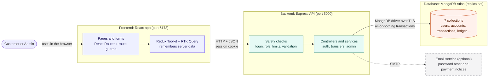
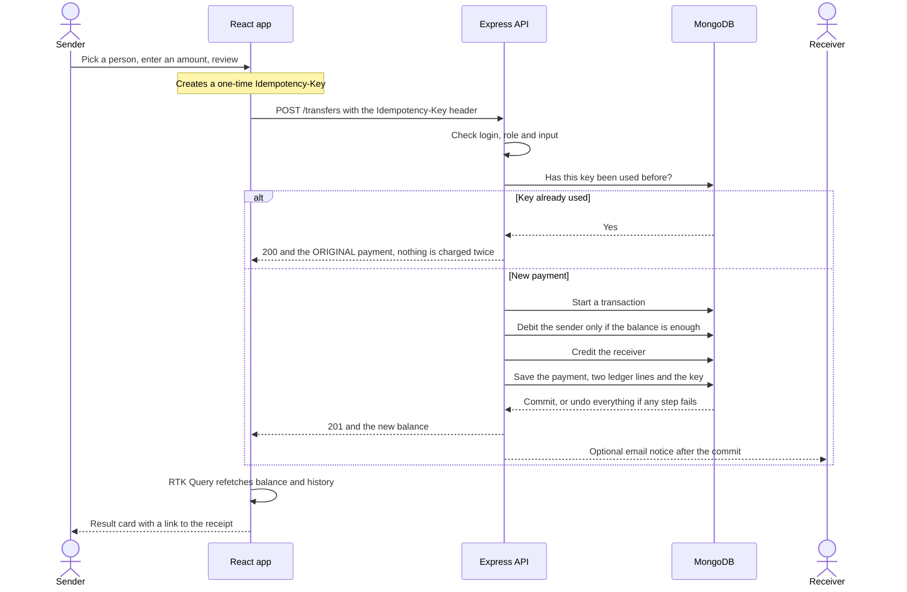

<div align="center">

# Bytebank

### A full-stack digital bank where money can't be lost, duplicated or overdrawn.

Atomic transfers · idempotent payments · audit-logged admin console · built with the MERN stack
*All money is simulated.*

<!-- LIVE DEMO: when you deploy, replace this comment with the two lines below.
**[Live demo](https://your-app.example.com)** · demo login: `demo@example.com` / `your-demo-password`
-->

[How it works](docs/HOW-IT-WORKS.md) ·
[Case study](docs/CASE-STUDY.md) ·
[Setup guide](docs/SETUP.md) ·
[Security](SECURITY.md)


<!-- CI BADGE: once you add GitHub Actions or tests, add a build/test status badge here. -->

</div>

<p align="center">
  
  
</p>
<p align="center">
  
  
</p>

## Why this project

Most portfolio apps are forms that save and show data. Bytebank is built around a harder question:
**what must be true for a system that moves money to be trustworthy?** Retries, double clicks, parallel requests and
half-finished operations are normal in the real world, and none of them may create, lose or duplicate a rupee.

**25 API endpoints · 7 database collections · 18 screens · customer and admin roles**

## Engineering challenges

| Problem | How it is solved |
|---|---|
| **Two requests spend the same money at once** | The debit is one conditional database operation (`balance >= amount`) inside a transaction. There is no read-then-write gap, so an overdraft cannot happen. |
| **A user double-clicks, or the connection drops mid-payment** | Each transfer carries an **Idempotency-Key**. A unique index plus a replay path means the same request always returns the original payment, never a second one. |
| **An admin creates money** | The **audit record is written inside the same transaction** as the deposit. If the audit row fails, the money is never created. |
| **How do you know nothing was lost?** | `npm run reconcile` checks all data: total balances equal total deposits, every balance matches its ledger, no balance is negative. It exits non-zero on any discrepancy. |
| **A suspended user keeps using an old login** | The server reloads the user on every request, so a suspension or password change takes effect on the very next call. |

## What it does

- **Customers:** live dashboard with chart and 30-second refresh · four-step send-money flow · history with search, filters, sorting and pagination (shareable by URL) · payment lookup · printable receipts · profile, password change and reset by email
- **Admins:** overview · customer search · suspend or reactivate · deposits with a required reason and a review step · all-transactions view · audit log
- **Quality:** strict validation on client and server · structured logs with request IDs and secret redaction · rate limiting · CSRF origin check · strict CSP · deny-by-default admin router

## How it works

A React app talks to an Express API, which is the only component that touches MongoDB and the only place where rules
are enforced. The code only calls downward: `routes → controllers → services → models`.



<details>
<summary><b>See how a payment works</b> (click to expand)</summary>

&nbsp;



- **No overdraft:** the debit only matches if the balance is enough, as one atomic database operation.
- **No half-finished payment:** debit, credit and records are one transaction. Any error undoes all of it.
- **No double payment:** a repeated request with the same `Idempotency-Key` returns the original payment.

</details>

More diagrams (sign-up, login, data model) are in **[docs/HOW-IT-WORKS.md](docs/HOW-IT-WORKS.md)**.

## Key decisions and trade-offs

| Decision | Why | Trade-off accepted |
|---|---|---|
| Money stored as integer **paise** | No floating-point rounding errors | Amounts are formatted for display only |
| Conditional atomic debit | Closes the race between "check" and "subtract" | Needs MongoDB transactions (a replica set) |
| Session in an **HTTP-only cookie** | Scripts cannot steal the token | Needs a CSRF origin check |
| User **reloaded on every request** | Suspension and password changes apply instantly | One extra database read per request |
| **Polling** every 30 seconds | Much simpler than WebSockets | Up to 30 seconds before an incoming payment appears |
| Audit log **inside** the money transaction | No money without a record of who created it | Admin writes are slightly heavier |

## Tech stack

| | |
|---|---|
| **Frontend** | React 18, Vite, React Router, Redux Toolkit + RTK Query, react-hook-form + zod, Tailwind CSS, shadcn/ui, Recharts |
| **Backend** | Node.js, Express, Mongoose, zod, JWT in an HTTP-only cookie, bcrypt, Helmet, pino |
| **Database** | MongoDB Atlas (replica set, for multi-document transactions) |

## Run it locally

You need Node.js 20+ and a free MongoDB Atlas cluster. Full instructions: **[docs/SETUP.md](docs/SETUP.md)**.

```bash
git clone https://github.com/YOUR-USERNAME/bytebank.git && cd bytebank

# backend (terminal 1)
cd server && npm install
cp .env.example .env        # then fill in MONGODB_URI and JWT_SECRET
npm run seed:admin && npm run dev

# frontend (terminal 2)
cd client && npm install && npm run dev
```

Open **http://localhost:5173**, sign up two customers, send money between them, then run `npm run reconcile` in `server/`.

## Security

Real `.env` files are never committed (only `.env.example` templates), and a pre-commit guard blocks accidental secrets.
The app uses HTTP-only cookies, strict input validation that rejects unknown fields, rate limits, CORS and CSRF protection,
and role-based access with a deny-by-default admin router. Details and how to report an issue: **[SECURITY.md](SECURITY.md)**.

## Known limitations and roadmap

Honest about what is not done yet:

- Rate limits are counted in one server process's memory, so they would not be shared across several servers
- Admin deposits have no idempotency key, so the screen never offers a blind retry after an unclear failure
- Sessions last two hours with no refresh token
- History uses offset pagination, which slows down on very deep pages

**Next:** automated tests (concurrency, idempotency, rollback) · email verification at signup · deployment · CSV export

## About the author

Built by **Your Name**, a full-stack developer who built Bytebank to learn how a frontend, a backend and a database fit
together by solving a problem where mistakes show up as wrong balances.

[GitHub](https://github.com/YOUR-USERNAME) · [LinkedIn](https://www.linkedin.com/in/your-profile) · [Email](mailto:your-email@example.com)

Released under the [MIT License](LICENSE).
