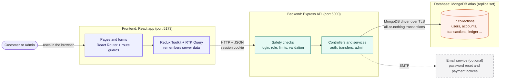
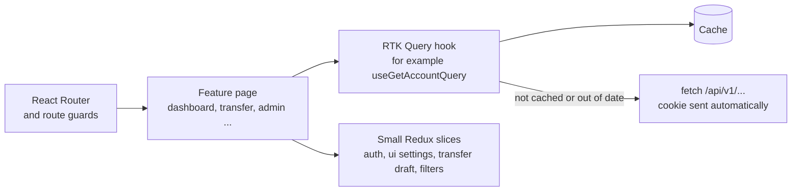
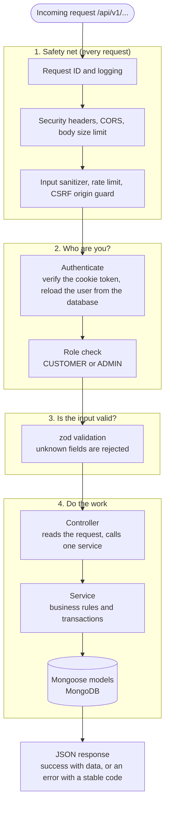
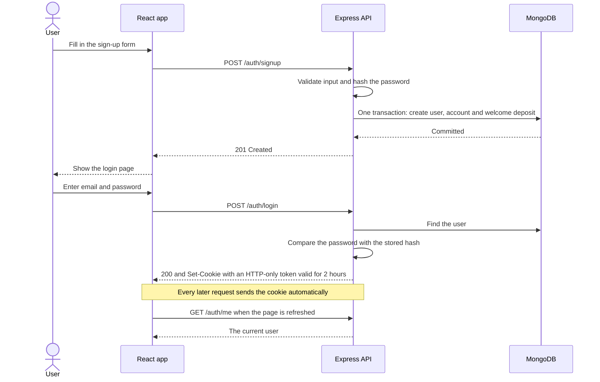
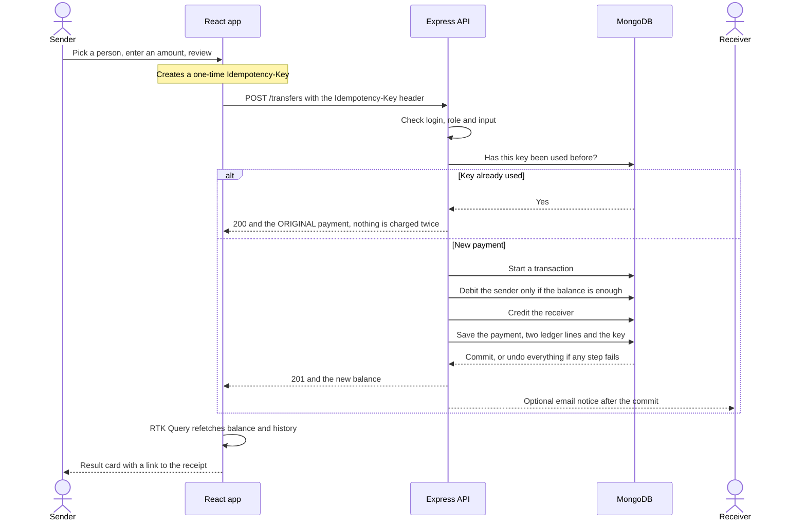
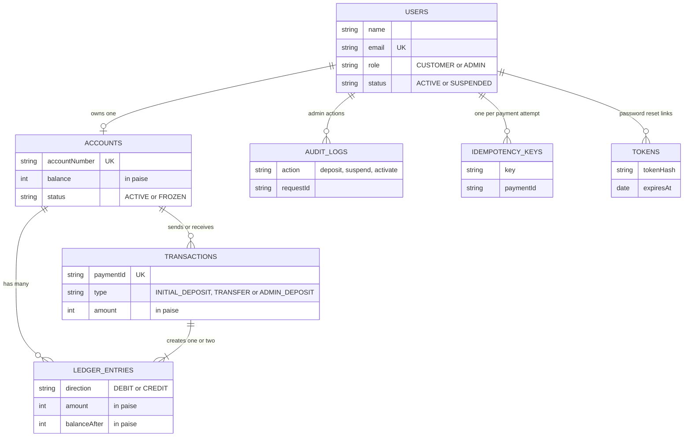

# How Bytebank works

Bytebank is a **simulated digital bank** built with the MERN stack (MongoDB, Express, React, Node.js).
People sign up, get ₹10,000 of pretend money, send it to each other, and see every payment in their history.
An admin can manage customers and add money. **No real money is ever involved.**

This page explains how it works and how it is built. It goes from the big picture down to the details,
so you can stop reading whenever you have what you need.

> This page describes the code as it is today. The diagrams are written in Mermaid, which GitHub draws automatically.

**Reading order:** the big picture (section 2) → how a request is handled (4) → how money moves (6) → the data (7).

---

## 1. What the app does

| Area | What a user can do | Who |
|---|---|---|
| Accounts | Sign up with name, email and password, then log in. A bank account and a ₹10,000 welcome balance are created at signup. | Everyone |
| Dashboard | See balance, money in and out (7, 30 or 90 days), a balance chart and recent activity. Updates by itself every 30 seconds. | Customer |
| Send money | Search a person, enter an amount, review, confirm. Safe to retry: a payment can never be applied twice. | Customer |
| History | Search by payment ID or name, filter by direction, type and date, sort, page through results. | Customer |
| Receipts | Open any payment, look it up by its payment ID, print or save a receipt. | Customer |
| Profile | Change name and password. Hide the balance. Turn animations off. | Customer |
| Password reset | Request a reset link by email (printed in the server terminal unless email is set up). | Everyone |
| Admin console | See totals, search customers, suspend or reactivate them, add money with a reason, browse all transactions. | Admin only |

---

## 2. The big picture

There are three parts. The **frontend** is what you see. The **backend** is the only thing allowed to touch the
database and the only place where rules are enforced. The **database** stores everything.



**Three things to remember**
- The browser **never decides anything about money**. It shows what the server says.
- The server **re-checks who you are on every request**, so suspending a user takes effect immediately.
- The database must be a **replica set**, because transfers use multi-step database transactions.

---

## 3. How the frontend is organized

Each screen lives in a **feature folder**. A screen asks for data through an **RTK Query hook**. The hook answers from its
cache when it can, and calls the API when it can't.



| Kind of state | Where it lives | Why |
|---|---|---|
| Data from the server (balance, history) | RTK Query cache | One source, refreshed after payments and every 30 s |
| Who is logged in | `authSlice` | Only used to decide which screens to show. The server still checks every request. |
| Preferences (hide balance, reduce effects) | `uiSlice`, saved in the browser | Remembered between visits. No money data is saved. |
| A transfer in progress | `transferDraftSlice` (memory only) | Cleared on logout. Holds the one-time Idempotency-Key. |
| History filters | `transactionsFilterSlice`, mirrored in the URL | Links to a filtered view can be shared and the Back button works. |

---

## 4. How the backend handles one request

Every request walks the same path. The first group protects the server, the second identifies the caller,
the third checks the input, and only then does the real work start.



**The layering rule:** code only calls downward: `routes → controllers → services → models`.
Controllers never touch the database, and services never touch the request object. That keeps every rule in one place.

**Every response has the same shape**, so the frontend handles errors the same way everywhere:
`{ "success": true, "data": ... }` or `{ "success": false, "error": { "code", "message", "requestId" } }`.

---

## 5. Sign up and log in

Signing up creates the user, the bank account and the welcome deposit **together**. If any part fails, none of it is saved.
Logging in stores a signed token in an **HTTP-only cookie**, which browser JavaScript cannot read.



---

## 6. Sending money (the heart of the app)

This is the most carefully built part. Three problems are solved on purpose:

1. **Overdraft:** the debit only happens if the balance is enough, checked inside the database operation itself.
2. **Half-finished payments:** debit, credit and records are one transaction. Any error undoes all of it.
3. **Double payment:** a one-time **Idempotency-Key** is sent with the request. Retrying returns the original payment.



**Limits:** ₹1 minimum and ₹50,000 maximum per transfer. You cannot pay yourself, and suspended accounts cannot send or receive.
Amounts are sent as text and stored as whole **paise** (integers), so rounding errors are impossible.

---

## 7. The data

Seven collections. Money lives in two places that must always agree: the **account balance** (fast to read)
and the **ledger** (an append-only history). A script, `npm run reconcile`, proves they agree.



- Admins have no account, so a user owns **zero or one** account.
- A transfer writes **two** ledger lines (a debit and a credit). A deposit writes **one**.
- Each payment stores the names of both people **as they were at the time**, so receipts never change if someone renames themselves.
- Idempotency keys and reset tokens delete themselves automatically after they expire.

---

## 8. Key design decisions

| Decision | Why |
|---|---|
| Money is whole paise, never decimals | Avoids rounding mistakes such as 0.1 + 0.2 |
| The server is the only authority | Anything the browser says about money or identity is ignored |
| The user is reloaded from the database on every request | Suspending someone, or changing a password, works at once |
| Related writes happen in one database transaction | No half-finished payments, no account without its welcome deposit |
| Idempotency-Key on payments | Safe retries after a slow connection or a double click |
| The admin router checks the role before any route is added | A new admin route is protected by default. A test enforces this. |
| An audit log row is written in the same transaction as the money | No audit record means no money moved |
| Dashboard polls every 30 seconds instead of using WebSockets | Much simpler, and enough for this app |
| Search, filters and paging happen on the server | The browser only ever holds one page of history |

---

## 9. Technology

| Layer | Technology |
|---|---|
| Frontend | React 18, Vite, React Router, Redux Toolkit with RTK Query, react-hook-form with zod |
| Frontend look | Tailwind CSS, shadcn/ui (Radix), Recharts, Motion |
| Backend | Node.js 20, Express 4, Mongoose, zod, JSON Web Tokens in an HTTP-only cookie, bcrypt |
| Backend safety | Helmet, CORS, rate limiting, input sanitizing, CSRF origin check, structured logs (pino) |
| Database | MongoDB Atlas (replica set) |
| Email (optional) | Nodemailer over SMTP. Defaults to printing in the terminal. |
| Tests | Vitest, Supertest, in-memory MongoDB replica set |

---

## 10. Project map

```
bytebank/
├─ client/                  the React app
│  └─ src/
│     ├─ app/               store and router
│     ├─ api/               one RTK Query file per backend area
│     ├─ features/          one folder per area: auth, dashboard, transfer,
│     │                     transactions, admin, profile  (pages, components, slices)
│     ├─ components/        ui (shadcn), shared pieces, animated effects
│     └─ layouts/ hooks/ lib/ styles/
├─ server/                  the API
│  ├─ src/
│  │  ├─ routes/            URL → controller (and which middleware applies)
│  │  ├─ controllers/       read the request, call a service, send the response
│  │  ├─ services/          the business rules and database transactions
│  │  ├─ models/            the 7 collections
│  │  ├─ middleware/        login, roles, rate limits, errors
│  │  └─ validators/ utils/ config/
│  ├─ scripts/              seed admin, backfill accounts, reconcile
│  └─ tests/                unit, integration and invariant tests
└─ docs/                    project documents
```

---

## 11. The API at a glance

25 endpoints, all under `/api/v1`.

| Area | Who can call it | Endpoints |
|---|---|---|
| `/auth` | Public, some need login | signup, login, logout, me, forgot-password, reset-password, change-password |
| `/account` | Logged in | account, summary |
| `/recipients` | Customer | search |
| `/transfers` | Customer | create a transfer |
| `/transactions` | Customer | list with filters, one payment, receipt |
| `/profile` | Logged in | read, update name |
| `/admin` | Admin only | overview, users, user detail, suspend or activate, transactions, deposits (list and create) |
| `/health` | Public | alive, ready |

---

## 12. How the claims are checked

- **Money can't be created or lost:** `npm run reconcile` checks that all balances equal the ledger and the deposits.
- **Concurrency:** a test fires 50 payments at once from a ₹1,000 balance. Exactly 10 succeed and the balance never goes negative.
- **No double payment:** tests send the same payment key five times in parallel and expect exactly one payment.
- **All or nothing:** a test crashes the server between the debit and the credit and checks that nothing changed.
- **Admin protection:** a test reads the real admin router and checks that every route rejects visitors and customers.

Run them with `npm test` inside `server/`.